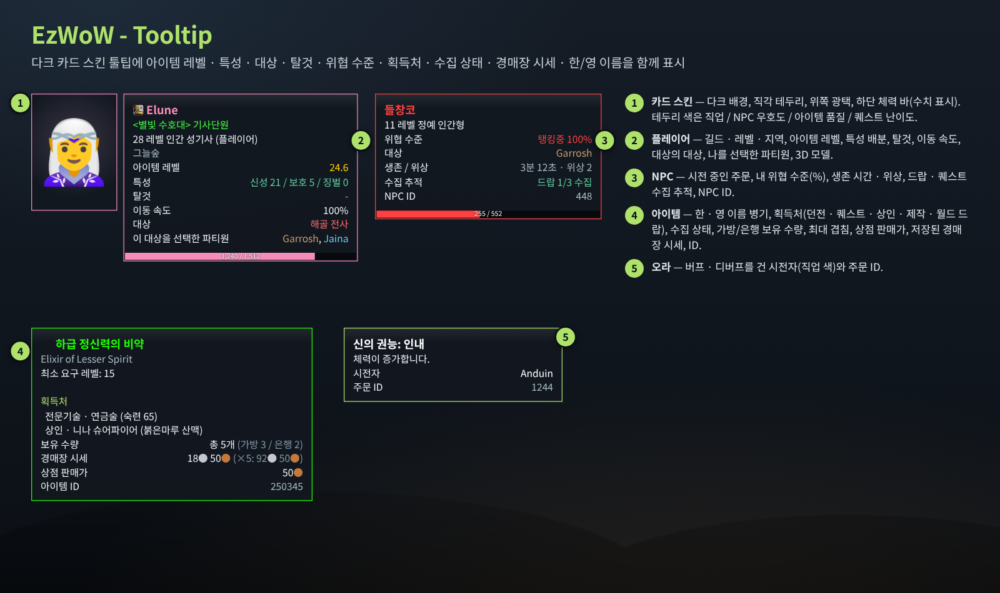
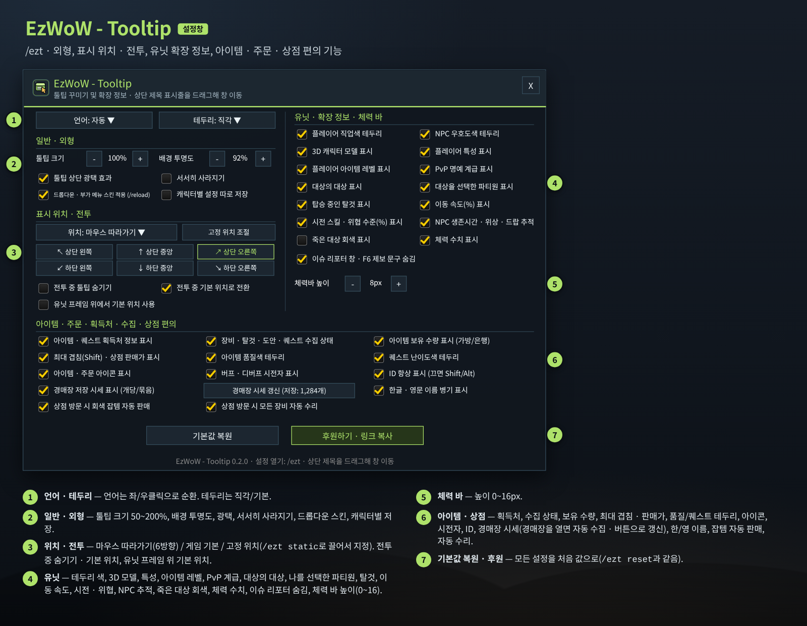
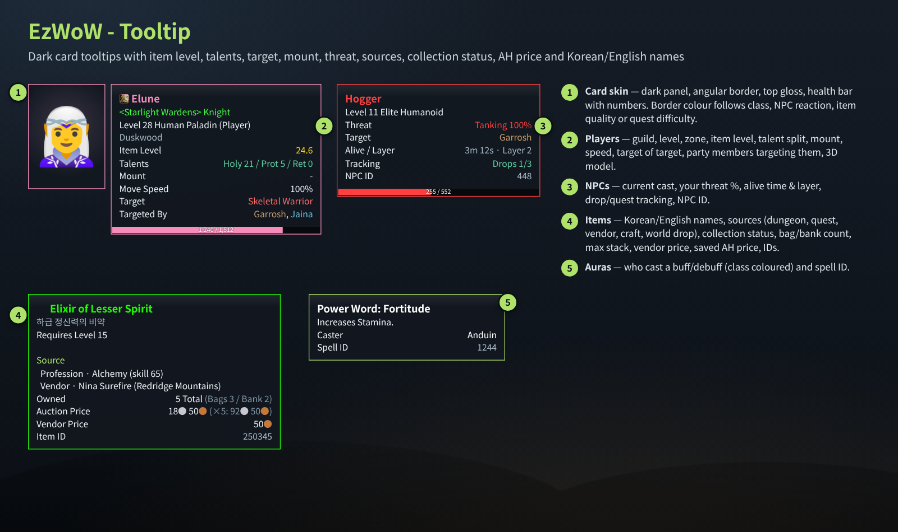
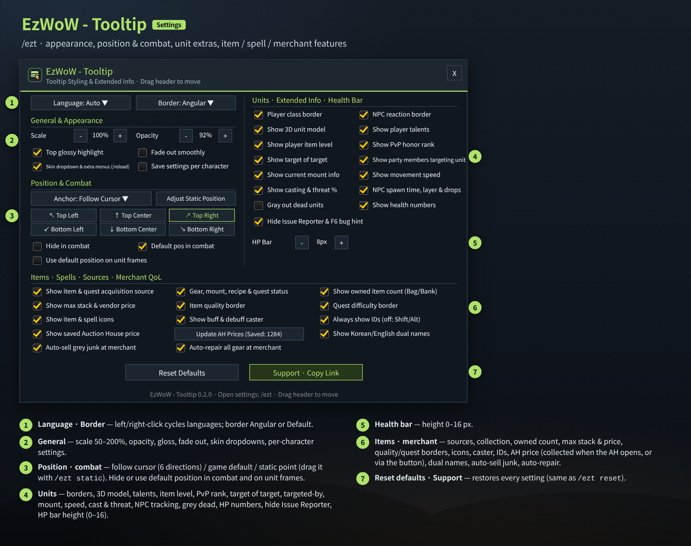

# EzWoW - Tooltip (`EzWoW-Tooltip`)

## CurseForge

- **Project ID / 프로젝트 ID:** `1755570`
- **Project page / 프로젝트 페이지:** [EzWoW-Tooltip](https://www.curseforge.com/wow/addons/ezwow-tooltip)

**[한국어](#한국어) · [English](#english)**

WoW Forever (`Interface: 16001`) · `/ezt`

---

## 한국어

### 개요

게임 툴팁을 **어두운 카드 모양**으로 깔끔하게 바꾸고, 정보를 더 붙여 주는 애드온입니다. 플레이어에는 아이템 레벨 · 특성 · 탈것 · 이동 속도 · 대상의 대상을, NPC에는 시전 주문 · 내 위협 수준 · 생존 시간 · 드랍 수집 추적을, 아이템에는 획득처 · 수집 상태 · 보유 수량 · 경매장 시세 · 한/영 이름을 보여 줍니다. 상점에 가면 잡템 자동 판매와 자동 수리도 해 줍니다.

### 화면 미리보기

> 이미지는 애드온 코드의 크기·색상·문구로 재현한 **예시 화면**입니다. 캐릭터 · 길드 이름과 숫자는 예시입니다(3D 모델 자리에는 그림을 넣었습니다).

### 설치

1. `EzWoW-Tooltip` 폴더를 `Interface/AddOns/` 폴더에 넣습니다.
2. 캐릭터 선택 화면의 **애드온** 목록에서 켭니다.
3. 바로 적용됩니다. 설정은 `/ezt`.

### 툴팁에 붙는 정보 (위 그림의 번호)

| 번호 | 툴팁 | 내용 |
|---|---|---|
| ① | 카드 스킨 · 3D 모델 | 다크 슬레이트 배경(`#12181F`), 직각/기본 테두리, 위쪽 광택, 부드럽게 사라지기, 아래쪽 체력 바(수치 표시). 테두리 색은 **플레이어 직업 / NPC 우호도 / 아이템 품질 / 퀘스트 난이도**를 따릅니다. 툴팁 옆에 3D 캐릭터·몬스터 모델을 띄울 수 있습니다. |
| ② | 플레이어 | 칭호 · 이름 · 길드(계급) · 레벨 · 종족 · 직업 · 지역, **평균 아이템 레벨**, **특성 배분**, 탈것, 이동 속도(%), **대상의 대상**, **이 대상을 선택한 파티원**, PvP 명예 계급. 아이템 레벨과 특성은 조사 후 캐시해 둡니다. |
| ③ | NPC | 레벨 · 정예 · 종류, **지금 시전 중인 주문**, **내 위협 수준(%)**, 대상, 생존 시간 · 위상, 드랍/퀘스트 수집 추적, NPC ID. |
| ④ | 아이템 | **한 · 영 이름 병기**, 획득처(던전 · 보스 · 퀘스트 · 상인 · 제작 · 월드 드랍 등, 내장 `Data/SourceDB.lua`), 수집 상태(형상 · 탈것 · 도안 · 퀘스트), **가방/은행 보유 수량**, 최대 겹침(Shift), 상점 판매가, **경매장 저장 시세**(개당/묶음), 아이템 ID. |
| ⑤ | 주문 · 오라 | 버프 · 디버프를 **건 사람(직업 색)**, 주문 ID, 아이콘. 툴팁 안의 지나치게 긴 소수점 숫자도 보기 좋게 정리합니다. |

#### 상점 편의

- **잡템 자동 판매**: 상점을 열면 회색 아이템을 팔고 번 금액을 채팅창에 알려 줍니다.
- **자동 수리**: 상점을 열면 모든 장비를 수리하고 비용을 알려 줍니다.
- **경매장 시세 저장**: 경매장을 열거나 검색할 때 최저 즉시 구매가를 모아 둡니다. 설정창 버튼으로 다시 수집할 수 있습니다.

### 설정창 (`/ezt`)

| 번호 | 항목 | 기본값 |
|---|---|---|
| ① | 언어 (좌/우클릭 순환) · 테두리(직각/기본) | 자동 · 직각 |
| ② | 툴팁 크기 50~200% · 배경 투명도 10~100% | 100% · 92% |
| ② | 툴팁 상단 광택 효과 · 서서히 사라지기 | 켬 · 끔 |
| ② | 드롭다운 · 부가 메뉴 스킨 적용 (/reload 필요) · 캐릭터별 설정 따로 저장 | 켬 · 끔 |
| ③ | 위치: 마우스 따라가기 / 게임 기본 위치 / 고정 위치 | 마우스 따라가기 |
| ③ | 마우스 따라가기 방향: 상단 왼쪽 · 중앙 · 오른쪽 / 하단 왼쪽 · 중앙 · 오른쪽 | 상단 오른쪽 |
| ③ | 고정 위치 조절 (`/ezt static`): 상자를 끌어 위치를 정하고 모서리 점으로 기준점을 바꿉니다. | - |
| ③ | 전투 중 툴팁 숨기기 · 전투 중 기본 위치로 전환 · 유닛 프레임 위에서 기본 위치 사용 | 끔 · 켬 · 끔 |
| ④ | 플레이어 직업색 테두리 · NPC 우호도색 테두리 | 켬 |
| ④ | 3D 캐릭터 모델 · 플레이어 특성 · 플레이어 아이템 레벨 · PvP 명예 계급 | 켬 |
| ④ | 대상의 대상 · 대상을 선택한 파티원 · 탑승 중인 탈것 · 이동 속도(%) | 켬 |
| ④ | 시전 스킬 · 위협 수준(%) · NPC 생존시간 · 위상 · 드랍 추적 | 켬 |
| ④ | 죽은 대상 회색 표시 · 체력 수치 표시 · 이슈 리포터 창 · F6 제보 문구 숨김 | 끔 · 켬 · 켬 |
| ⑤ | 체력바 높이 0~16px | 8px |
| ⑥ | 아이템·퀘스트 획득처 · 수집 상태 · 보유 수량(가방/은행) · 최대 겹침·판매가 | 켬 |
| ⑥ | 아이템 품질색 테두리 · 퀘스트 난이도색 테두리 · 아이템·주문 아이콘 · 버프·디버프 시전자 | 켬 |
| ⑥ | ID 항상 표시 (끄면 Shift/Alt를 누를 때만) | 켬 |
| ⑥ | 경매장 저장 시세 표시 · [경매장 시세 갱신] 버튼 · 한글·영문 이름 병기 | 켬 |
| ⑥ | 상점 방문 시 회색 잡템 자동 판매 · 모든 장비 자동 수리 | 켬 · 켬 |
| ⑦ | 기본값 복원 · 후원하기 | - |

### 명령어 (`/ezt`, `/et`, `/eztooltip`, `/ezwowtooltip`, `/툴팁`)

| 명령어 | 설명 |
|---|---|
| `/ezt` | 설정창 열기/닫기 |
| `/ezt static` (`anchor`) | 고정 위치 조절 상자 열기/닫기 |
| `/ezt reset` | 모든 설정을 기본값으로 |
| `/ezt lang <auto\|ko\|en\|de\|fr\|es\|ru\|cn\|tw>` | 표시 언어 변경 |
| `/ezt debug` | 다음에 마우스를 올린 유닛 툴팁의 줄 구조 진단 |

### 저장 데이터

- `EzWoW_TooltipDB` (계정 공통): 설정, 경매장 시세.
- `EzWoW_TooltipPerCharDB` (캐릭터별): “캐릭터별 설정 따로 저장”을 켰을 때의 설정.

### 알아두면 좋은 점

- 자동 판매 · 자동 수리는 기본으로 켜져 있습니다. 원하지 않으면 설정창에서 끄세요.
- 드롭다운 스킨 옵션은 `/reload` 후에 적용됩니다.

---

## English

### Overview

EzWoW - Tooltip turns game tooltips into **clean dark cards** and adds useful information: item level, talents, mount, speed and target of target for players; current cast, your threat, alive time and drop tracking for NPCs; sources, collection status, owned count, AH price and Korean/English names for items. At merchants it can also sell junk and repair automatically.

### Screenshots

> These are **mock-ups** rebuilt from the sizes, colours and strings in the code. Character/guild names and numbers are examples (a picture stands in for the 3D model).

### Installation

1. Copy the `EzWoW-Tooltip` folder into `Interface/AddOns/`.
2. Enable it in the **AddOns** list on the character select screen.
3. It applies immediately. Settings: `/ezt`.

### What the tooltips show (numbers in the picture)

| No. | Tooltip | Contents |
|---|---|---|
| ① | Card skin · 3D model | Dark slate background (`#12181F`), angular/default border, top gloss, optional fade-out and a health bar with numbers. Border colour follows **class / NPC reaction / item quality / quest difficulty**. A 3D model of the unit can be shown next to the tooltip. |
| ② | Players | Title, name, guild (rank), level, race, class, zone, **average item level**, **talent split**, mount, movement speed (%), **target of target**, **party members targeting the unit**, PvP honor rank. Item level and talents are inspected and cached. |
| ③ | NPCs | Level, elite, type, **current cast**, **your threat (%)**, target, alive time and layer, drop/quest tracking, NPC ID. |
| ④ | Items | **Korean/English dual name**, sources (dungeon, boss, quest, vendor, craft, world drop… from the bundled `Data/SourceDB.lua`), collection status (appearance, mount, recipe, quest), **bag/bank count**, max stack (Shift), vendor price, **saved AH price** (each/stack), item ID. |
| ⑤ | Spells · auras | **Who cast** a buff/debuff (class-coloured), spell ID, icon. Overly long decimals inside tooltips are tidied up. |

#### Merchant conveniences

- **Auto-sell junk**: grey items are sold when you open a merchant, with the total in chat.
- **Auto-repair**: all gear is repaired at merchants and the cost is reported.
- **AH prices**: lowest buyouts are collected while you open or search the Auction House; the settings button rescans.

### Settings window (`/ezt`)

| No. | Option | Default |
|---|---|---|
| ① | Language (left/right click cycles) · Border (Angular/Default) | Auto · Angular |
| ② | Scale 50–200% · Opacity 10–100% | 100% · 92% |
| ② | Top glossy highlight · Fade out smoothly | On · Off |
| ② | Skin dropdown & extra menus (needs /reload) · Save settings per character | On · Off |
| ③ | Anchor: Follow Cursor / Game Default / Static Point | Follow Cursor |
| ③ | Cursor direction: Top Left · Center · Right / Bottom Left · Center · Right | Top Right |
| ③ | Adjust Static Position (`/ezt static`): drag the box to place it and click a corner to set the growth anchor. | - |
| ③ | Hide in combat · Default pos in combat · Use default position on unit frames | Off · On · Off |
| ④ | Player class border · NPC reaction border | On |
| ④ | 3D unit model · Player talents · Player item level · PvP honor rank | On |
| ④ | Target of target · Party members targeting unit · Current mount · Movement speed | On |
| ④ | Casting & threat % · NPC spawn time, layer & drops | On |
| ④ | Gray out dead units · Show health numbers · Hide Issue Reporter & F6 bug hint | Off · On · On |
| ⑤ | HP bar height 0–16 px | 8 px |
| ⑥ | Item & quest source · Collection status · Owned count (Bag/Bank) · Max stack & vendor price | On |
| ⑥ | Item quality border · Quest difficulty border · Item & spell icons · Buff & debuff caster | On |
| ⑥ | Always show IDs (off: only with Shift/Alt) | On |
| ⑥ | Saved AH price · [Update AH Prices] button · Korean/English dual names | On |
| ⑥ | Auto-sell grey junk · Auto-repair all gear at merchant | On · On |
| ⑦ | Reset Defaults · Support | - |

### Slash commands (`/ezt`, `/et`, `/eztooltip`, `/ezwowtooltip`, `/툴팁`)

| Command | Description |
|---|---|
| `/ezt` | Open/close settings |
| `/ezt static` (`anchor`) | Toggle the static-position box |
| `/ezt reset` | Restore all defaults |
| `/ezt lang <auto\|ko\|en\|de\|fr\|es\|ru\|cn\|tw>` | Change display language |
| `/ezt debug` | Diagnose the line layout of the next unit tooltip you hover |

### Saved data

- `EzWoW_TooltipDB` (account-wide): settings, AH prices.
- `EzWoW_TooltipPerCharDB` (per character): settings when “Save settings per character” is on.

### Tips

- Auto-sell and auto-repair are on by default; turn them off in settings if you do not want them.
- The dropdown skin option takes effect after `/reload`.

---

## Support / 후원

If you find this addon useful, you can support its development.

애드온이 도움이 되셨다면 개발 후원으로 응원해 주세요.

[Buy Me a Coffee ☕](https://buymeacoffee.com/qqhrqqhr2)
