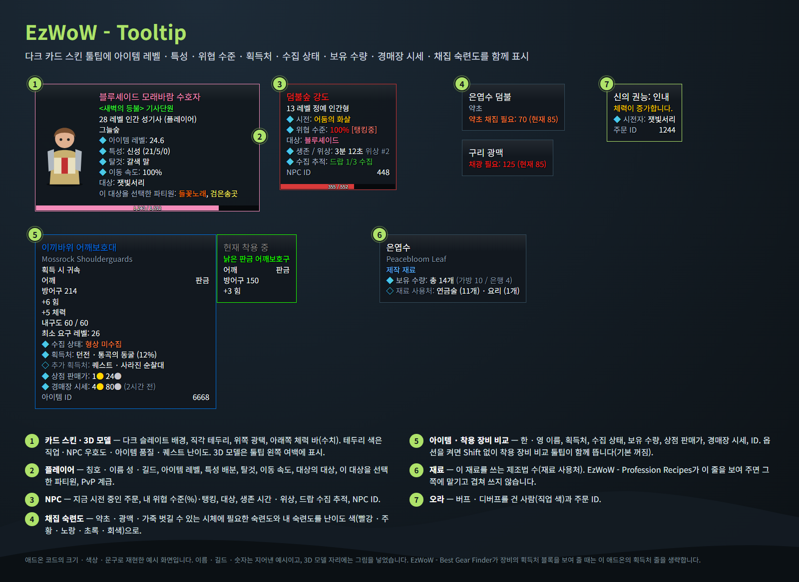
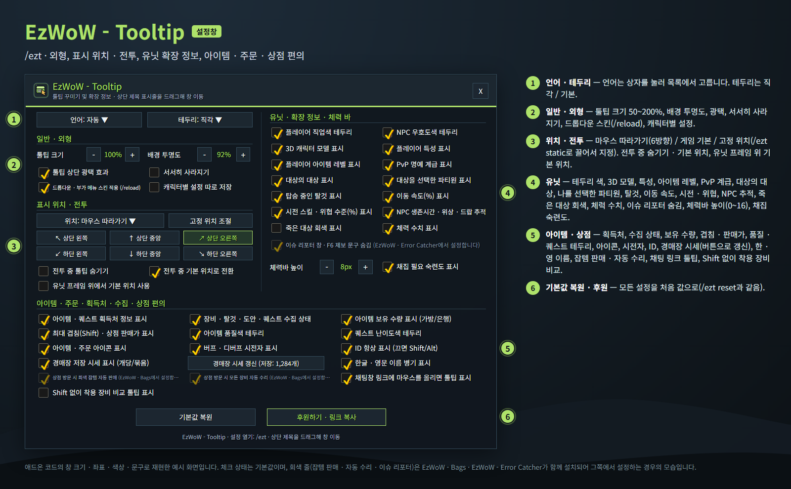
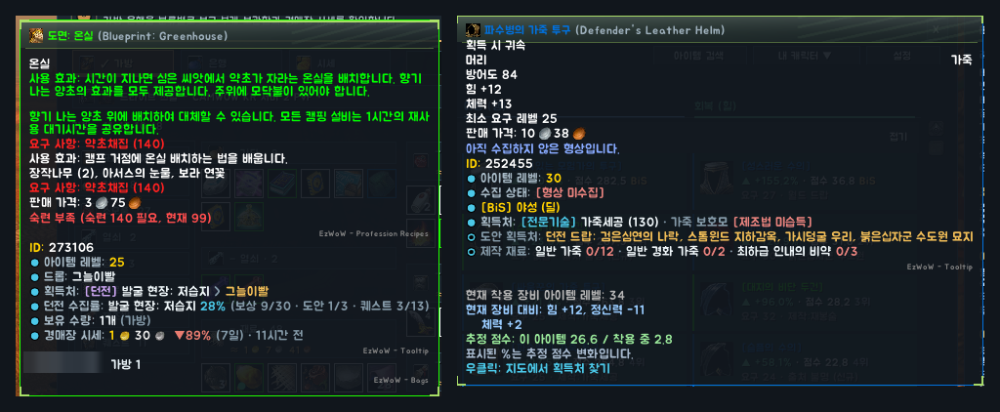
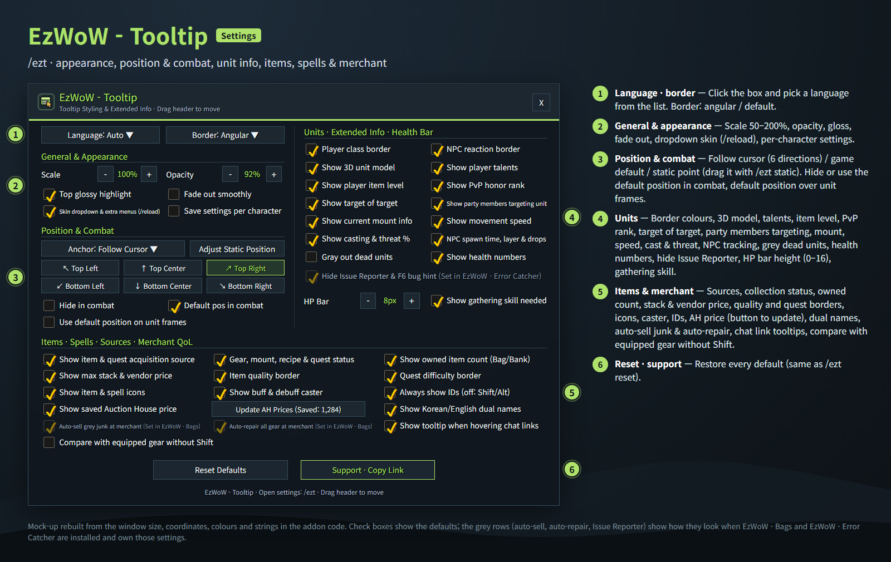

# EzWoW - Tooltip (`EzWoW-Tooltip`)

## CurseForge

- **Project ID / 프로젝트 ID:** `1755570`
- **Project page / 프로젝트 페이지:** [EzWoW-Tooltip](https://www.curseforge.com/wow/addons/ezwow-tooltip)

**[한국어](#한국어) · [English](#english)**

WoW Forever (`Interface: 16001`) · `/ezt`

---

## 한국어

### 개요

게임 툴팁을 **어두운 카드 모양**으로 깔끔하게 바꾸고, 정보를 더 붙여 주는 애드온입니다. 플레이어에는 아이템 레벨 · 특성 · 탈것 · 이동 속도 · 대상의 대상을, NPC에는 시전 주문 · 내 위협 수준 · 생존 시간 · 드랍 수집 추적을, 아이템에는 획득처 · 수집 상태 · 보유 수량 · 경매장 시세 · 한/영 이름을 보여 줍니다. 약초 · 광맥에는 필요한 채집 숙련도를 표시하고, 원하면 Shift 없이도 착용 장비 비교 툴팁을 띄웁니다.

### 화면 미리보기

> 실제 게임 화면입니다(WoW Forever, 한국어 클라이언트). 캐릭터 · 다른 플레이어 이름과 채팅 내용은 가렸습니다.

### 설치

1. `EzWoW-Tooltip` 폴더를 `Interface/AddOns/` 폴더에 넣습니다.
2. 캐릭터 선택 화면의 **애드온** 목록에서 켭니다.
3. 바로 적용됩니다. 설정은 `/ezt`.

### 툴팁에 붙는 정보

| 번호 | 툴팁 | 내용 |
|---|---|---|
| ① | 카드 스킨 · 3D 모델 | 다크 슬레이트 배경(`#12181F`), 직각/기본 테두리, 위쪽 광택, 부드럽게 사라지기, 아래쪽 체력 바(수치 표시). 테두리 색은 **플레이어 직업 / NPC 우호도 / 아이템 품질 / 퀘스트 난이도**를 따릅니다. 3D 캐릭터 · 몬스터 모델은 툴팁 왼쪽 여백에 표시합니다. 이 애드온이 덧붙인 줄 끝에는 작은 회색 글자로 “EzWoW - Tooltip”이 오른쪽에 붙어, 어느 줄이 이 애드온의 것인지 알 수 있습니다. |
| ② | 플레이어 | 칭호 · **이름 성** · 길드(계급) · 레벨 · 종족 · 직업 · 지역, **평균 아이템 레벨**, **특성 배분**, 탈것, 이동 속도(%), **대상의 대상**, **이 대상을 선택한 파티원**, PvP 계급. 아이템 레벨과 특성은 조사 후 캐시해 둡니다. |
| ③ | NPC | 레벨 · 정예 · 종류, **지금 시전 중인 주문**, **내 위협 수준(%) · 탱킹 여부**, 대상, 생존 시간 · 위상, 드랍 수집 추적, NPC ID. |
| ④ | 채집 숙련도 | 약초 · 광맥 · 가죽을 벗길 수 있는 시체 툴팁에 **필요한 숙련도와 내 숙련도**를 난이도 색(빨강 · 주황 · 노랑 · 초록 · 회색)으로 표시합니다. 배우지 않은 기술은 “미습득”. |
| ⑤ | 아이템 · 착용 장비 비교 | **한 · 영 이름 병기**, 획득처(던전 · 보스 · 퀘스트 · 상인 · 제작 · 월드 드랍 등, 내장 `Data/SourceDB.lua`), 수집 상태(형상 · 탈것 · 도안 · 퀘스트), **가방/은행 보유 수량**, 최대 겹침(Shift), 상점 판매가, **경매장 저장 시세**(개당/묶음, 수집한 지 얼마나 됐는지), 아이템 ID. **Shift 없이 착용 장비 비교** 옵션을 켜면 착용 중인 장비 툴팁이 나란히 뜹니다(기본 꺼짐). 획득처 · 수집 · 보유 줄은 이름 아래 한 묶음으로 나오고, 획득처가 여러 곳이면 “외 N곳”으로 줄였다가 **Shift**를 누르면 펼칩니다. EzWoW 사용자가 게임에서 확인한 상점은 “판매:” 줄로 나오고, 도안에는 도안 자체의 획득처가 붙습니다. |
| ⑥ | 재료 | 그 재료를 쓰는 제조법 수(**재료 사용처**)와 보유 수량. |
| ⑦ | 주문 · 오라 | 버프 · 디버프를 **건 사람(직업 색)**, 주문 ID, 아이콘. 툴팁 안의 지나치게 긴 소수점 숫자도 보기 좋게 정리합니다. |

#### 상점 편의

- **잡템 자동 판매**: 상점을 열면 회색 아이템을 팔고 번 금액을 채팅창에 알려 줍니다.
- **자동 수리**: 상점을 열면 모든 장비를 수리하고 비용을 알려 줍니다.
- **경매장 시세 저장**: 경매장을 열거나 검색할 때 최저 즉시 구매가를 모아 둡니다. 설정창의 [경매장 시세 갱신] 버튼으로 전체를 다시 수집할 수 있습니다.
- 상점을 열 때 **Shift**를 누르고 있으면 자동 판매 · 수리를 건너뜁니다.

#### 다른 EzWoW 애드온과 함께 쓰기

같은 정보가 두 번 나오지 않도록, 다음 애드온이 설치되어 있으면 해당 기능은 그 애드온이 맡습니다.

| 함께 설치한 애드온 | 그쪽이 맡는 기능 | 이 애드온 |
|---|---|---|
| EzWoW - Bags | 잡템 자동 판매 · 자동 수리 | 설정 칸이 회색이 되고 “EzWoW - Bags에서 설정합니다”가 붙습니다. |
| EzWoW - Bags | 시세 기록 · 등락 | 경매장 시세 줄 끝에 EzWoW - Bags가 기록한 **7일 평균 대비 등락**(▲/▼%)이 붙고, 전체 시세 수집 때 매물 수량을 EzWoW - Bags의 시세 기록에 넘겨 줍니다. |
| EzWoW - Error Catcher | 이슈 리포터 창 · F6 제보 문구 숨김 | 설정 칸이 회색이 되고 “EzWoW - Error Catcher에서 설정합니다”가 붙습니다. |
| EzWoW - Best Gear Finder | 장비 툴팁의 획득처 블록(드랍 · 퀘스트 · 상인 · 제작 재료) | 그 장비에서는 이 애드온의 획득처 줄을 생략합니다. |
| EzWoW - Profession Recipes | 재료 툴팁의 “재료 사용처”, 도안 아이템의 배움/배울 수 있음 표시 | 그 아이템에서는 이 애드온의 해당 줄을 생략합니다. |

### 설정창 (`/ezt`)

| 번호 | 항목 | 기본값 |
|---|---|---|
| ① | 언어 (상자를 누르고 목록에서 고름) · 테두리(직각/기본) | 자동 · 직각 |
| ② | 툴팁 크기 50~200% · 배경 투명도 10~100% | 100% · 92% |
| ② | 툴팁 상단 광택 효과 · 서서히 사라지기 | 켬 · 끔 |
| ② | 드롭다운 · 부가 메뉴 스킨 적용 (/reload 필요) · 캐릭터별 설정 따로 저장 | 켬 · 끔 |
| ③ | 위치: 마우스 따라가기 / 게임 기본 위치 / 고정 위치 | 마우스 따라가기 |
| ③ | 마우스 따라가기 방향: 상단 왼쪽 · 중앙 · 오른쪽 / 하단 왼쪽 · 중앙 · 오른쪽 | 상단 오른쪽 |
| ③ | 고정 위치 조절 (`/ezt static`): 상자를 끌어 위치를 정하고 모서리 점으로 기준점을 바꿉니다. | - |
| ③ | 전투 중 툴팁 숨기기 · 전투 중 기본 위치로 전환 · 유닛 프레임 위에서 기본 위치 사용 | 끔 · 켬 · 끔 |
| ④ | 플레이어 직업색 테두리 · NPC 우호도색 테두리 | 켬 |
| ④ | 3D 캐릭터 모델 · 플레이어 특성 · 플레이어 아이템 레벨 · PvP 명예 계급 | 켬 |
| ④ | 대상의 대상 · 대상을 선택한 파티원 · 탑승 중인 탈것 · 이동 속도(%) | 켬 |
| ④ | 시전 스킬 · 위협 수준(%) · NPC 생존시간 · 위상 · 드랍 추적 | 켬 |
| ④ | 죽은 대상 회색 표시 · 체력 수치 표시 | 끔 · 켬 |
| ④ | 이슈 리포터 창 · F6 제보 문구 숨김 (EzWoW - Error Catcher가 있으면 그쪽에서 설정) | 켬 |
| ④ | 체력바 높이 0~16px · 채집 필요 숙련도 표시 | 8px · 켬 |
| ⑤ | 아이템 · 퀘스트 획득처 · 수집 상태 · 보유 수량(가방/은행) · 최대 겹침 · 판매가 | 켬 |
| ⑤ | 아이템 품질색 테두리 · 퀘스트 난이도색 테두리 · 아이템 · 주문 아이콘 · 버프 · 디버프 시전자 | 켬 |
| ⑤ | ID 항상 표시 (끄면 Shift/Alt를 누를 때만) | 켬 |
| ⑤ | 경매장 저장 시세 표시 · [경매장 시세 갱신] 버튼 · 한글 · 영문 이름 병기 | 켬 |
| ⑤ | 상점 방문 시 회색 잡템 자동 판매 · 모든 장비 자동 수리 (EzWoW - Bags가 있으면 그쪽에서 설정) | 켬 · 켬 |
| ⑤ | 채팅창 링크에 마우스를 올리면 툴팁 표시 | 켬 |
| ⑤ | Shift 없이 착용 장비 비교 툴팁 표시 (게임의 “항상 아이템 비교” 설정을 켭니다) | 끔 |
| ⑥ | 기본값 복원 · 후원하기 | - |

### 명령어 (`/ezt`, `/et`, `/eztooltip`, `/ezwowtooltip`, `/툴팁`)

| 명령어 | 설명 |
|---|---|
| `/ezt` | 설정창 열기/닫기 |
| `/ezt static` (`anchor`) | 고정 위치 조절 상자 열기/닫기 |
| `/ezt reset` | 모든 설정을 기본값으로 |
| `/ezt lang <auto\|ko\|en\|de\|fr\|es\|ru\|cn\|tw>` | 표시 언어 변경 |
| `/ezt debug` | 다음에 마우스를 올린 유닛 툴팁의 줄 구조 진단 |

### 저장 데이터

- `EzWoW_TooltipDB` (계정 공통): 설정, 경매장 시세.
- `EzWoW_TooltipPerCharDB` (캐릭터별): “캐릭터별 설정 따로 저장”을 켰을 때의 설정.

### 알아두면 좋은 점

- 자동 판매 · 자동 수리는 기본으로 켜져 있습니다. 원하지 않으면 설정창에서 끄세요(EzWoW - Bags가 있으면 그쪽 설정을 따릅니다).
- “Shift 없이 착용 장비 비교”는 이 애드온이 켠 경우에만 끌 때 게임 설정을 되돌립니다. 예전에 EzWoW - Best Gear Finder에서 이 기능을 꺼 두었다면 그 선택을 그대로 이어받습니다.
- 드롭다운 스킨 옵션은 `/reload` 후에 적용됩니다.

<!-- ezwow-pad-share -->
### 게임패드
- 게임패드 UI를 켜면 EzWoW 창을 패드로 다룰 수 있습니다. 방향키로 이동, A(✕)로 누르기, X(□)로 오른쪽 클릭, LB/RB로 스크롤, B(○)로 닫기입니다. 창 아래에 연결된 패드 모양으로 키 안내가 나옵니다.
- 블리자드 창이 열려 있지 않을 때 **보기(Back) / Create 버튼**을 누르면 화면의 EzWoW 프레임(유틸리티 바, 퀘스트 목록 등)으로 이동합니다. 다시 누르거나 B를 누르면 돌아갑니다.
- 다른 버튼을 쓰려면 설정 > 단축키 > 애드온 > EzWoW > "게임패드: EzWoW 창으로 이동/돌아가기"에 지정합니다(EzWoW-MapFinder가 설치돼 있을 때).

### 기록 공유
- 모든 EzWoW 애드온이 함께 쓰는 기록 공유가 **기본으로 켜져 있습니다**. 직접 확인한 퀘스트 NPC, 희귀 몬스터 목격, 아이템 드롭, 채집 위치를 다른 EzWoW 사용자와 나눕니다.
- `/ezshare` 또는 `/공유`: `on` / `off` 켜기·끄기, `channel on` / `channel off` 서버 채널 사용, `status` 현재 상태와 기록 수.

---

## English

### Overview

EzWoW - Tooltip turns game tooltips into **clean dark cards** and adds useful information: item level, talents, mount, speed and target of target for players; current cast, your threat, alive time and drop tracking for NPCs; sources, collection status, owned count, AH price and Korean/English names for items. Herbs and ore veins show the gathering skill they need, and the equipped-gear comparison can open without holding Shift.

### Screenshots

> In-game screenshots (WoW Forever, Korean client). Character and player names and chat text are blurred.

### Installation

1. Copy the `EzWoW-Tooltip` folder into `Interface/AddOns/`.
2. Enable it in the **AddOns** list on the character select screen.
3. It applies immediately. Settings: `/ezt`.

### What the tooltips show

| No. | Tooltip | Contents |
|---|---|---|
| ① | Card skin · 3D model | Dark slate background (`#12181F`), angular/default border, top gloss, optional fade-out and a health bar with numbers. Border colour follows **class / NPC reaction / item quality / quest difficulty**. The 3D model of the unit sits in the tooltip's left margin. The lines this addon adds end with a small grey, right-aligned “EzWoW - Tooltip” tag so you can tell them apart. |
| ② | Players | Title, **first name and surname**, guild (rank), level, race, class, zone, **average item level**, **talent split**, mount, movement speed (%), **target of target**, **party members targeting the unit**, PvP rank. Item level and talents are inspected and cached. |
| ③ | NPCs | Level, elite, type, **current cast**, **your threat (%) and tanking**, target, alive time and layer, drop/quest tracking, NPC ID. |
| ④ | Gathering skill | Herbs, ore veins and skinnable corpses show the **required and your current skill** in difficulty colours (red, orange, yellow, green, grey), or “not learned”. |
| ⑤ | Items · compare with equipped | **Korean/English dual name**, sources (dungeon, boss, quest, vendor, craft, world drop… from the bundled `Data/SourceDB.lua`), collection status (appearance, mount, recipe, quest), **bag/bank count**, max stack (Shift), vendor price, **saved AH price** (each/stack, with its age), item ID. With **Compare with equipped gear without Shift** on, the equipped item's tooltip opens next to it (off by default). Source, collection and count lines come as one block under the name; many sources are cut to “+N more” and open with **Shift**. Shops EzWoW users saw in the game show as a “Sold by:” line, and recipes show where the recipe itself comes from. |
| ⑥ | Reagents | How many recipes use the item (**Used In**) and how many you own. |
| ⑦ | Spells · auras | **Who cast** a buff/debuff (class-coloured), spell ID, icon. Overly long decimals inside tooltips are tidied up. |

#### Merchant conveniences

- **Auto-sell junk**: grey items are sold when you open a merchant, with the total in chat.
- **Auto-repair**: all gear is repaired at merchants and the cost is reported.
- **AH prices**: lowest buyouts are collected while you open or search the Auction House; the [Update AH Prices] button in settings rescans everything.
- Hold **Shift** while opening a merchant to skip auto-sell and auto-repair.

#### Working with other EzWoW addons

So that nothing shows twice, these addons take over the matching feature when they are installed.

| Installed addon | Feature it takes over | This addon |
|---|---|---|
| EzWoW - Bags | Auto-sell junk · auto-repair | The check boxes turn grey with “Set in EzWoW - Bags”. |
| EzWoW - Bags | Price history · trend | The AH price line gets the **change against the 7-day average** (▲/▼%) recorded by EzWoW - Bags, and a full price scan hands the listed quantities to its price history. |
| EzWoW - Error Catcher | Hiding the Issue Reporter and the F6 bug hint | The check box turns grey with “Set in EzWoW - Error Catcher”. |
| EzWoW - Best Gear Finder | The source block on gear tooltips (drops, quests, vendors, crafting reagents) | Leaves out its own source lines for that item. |
| EzWoW - Profession Recipes | “Used In” on reagents, learned / can-learn status on recipe items | Leaves out its own lines for that item. |

### Settings window (`/ezt`)

| No. | Option | Default |
|---|---|---|
| ① | Language (click the box, pick from the list) · Border (Angular/Default) | Auto · Angular |
| ② | Scale 50–200% · Opacity 10–100% | 100% · 92% |
| ② | Top glossy highlight · Fade out smoothly | On · Off |
| ② | Skin dropdown & extra menus (needs /reload) · Save settings per character | On · Off |
| ③ | Anchor: Follow Cursor / Game Default / Static Point | Follow Cursor |
| ③ | Cursor direction: Top Left · Center · Right / Bottom Left · Center · Right | Top Right |
| ③ | Adjust Static Position (`/ezt static`): drag the box to place it and click a corner to set the growth anchor. | - |
| ③ | Hide in combat · Default pos in combat · Use default position on unit frames | Off · On · Off |
| ④ | Player class border · NPC reaction border | On |
| ④ | 3D unit model · Player talents · Player item level · PvP honor rank | On |
| ④ | Target of target · Party members targeting unit · Current mount · Movement speed | On |
| ④ | Casting & threat % · NPC spawn time, layer & drops | On |
| ④ | Gray out dead units · Show health numbers | Off · On |
| ④ | Hide Issue Reporter & F6 bug hint (set in EzWoW - Error Catcher when it is installed) | On |
| ④ | HP bar height 0–16 px · Show gathering skill needed | 8 px · On |
| ⑤ | Item & quest source · Collection status · Owned count (Bag/Bank) · Max stack & vendor price | On |
| ⑤ | Item quality border · Quest difficulty border · Item & spell icons · Buff & debuff caster | On |
| ⑤ | Always show IDs (off: only with Shift/Alt) | On |
| ⑤ | Saved AH price · [Update AH Prices] button · Korean/English dual names | On |
| ⑤ | Auto-sell grey junk · Auto-repair all gear at merchant (set in EzWoW - Bags when it is installed) | On · On |
| ⑤ | Show tooltip when hovering chat links | On |
| ⑤ | Compare with equipped gear without Shift (turns on the game's “always compare items” setting) | Off |
| ⑥ | Reset Defaults · Support | - |

### Slash commands (`/ezt`, `/et`, `/eztooltip`, `/ezwowtooltip`, `/툴팁`)

| Command | Description |
|---|---|
| `/ezt` | Open/close settings |
| `/ezt static` (`anchor`) | Toggle the static-position box |
| `/ezt reset` | Restore all defaults |
| `/ezt lang <auto\|ko\|en\|de\|fr\|es\|ru\|cn\|tw>` | Change display language |
| `/ezt debug` | Diagnose the line layout of the next unit tooltip you hover |

### Saved data

- `EzWoW_TooltipDB` (account-wide): settings, AH prices.
- `EzWoW_TooltipPerCharDB` (per character): settings when “Save settings per character” is on.

### Tips

- Auto-sell and auto-repair are on by default; turn them off in settings if you do not want them (with EzWoW - Bags installed, its settings apply).
- Turning “Compare with equipped gear without Shift” off restores the game setting only if this addon turned it on. If you had turned this off in EzWoW - Best Gear Finder before, that choice is kept.
- The dropdown skin option takes effect after `/reload`.

### Gamepad
- With the gamepad UI on, EzWoW windows work with a gamepad: D-pad to move, A (✕) to press, X (□) for right-click, LB/RB to scroll, B (○) to close. A key guide in your pad's button style shows under the window.
- With no game window open, press **View (Back) / Create** to move to the EzWoW frames on screen (Utility Bar, quest list and more). Press it again or B to go back.
- To use another button, set Key Bindings > AddOns > EzWoW > "Gamepad: move to / leave the EzWoW frames" (with EzWoW-MapFinder installed).

### Record sharing
- Record sharing, used by all EzWoW addons, is **on by default**. Quest NPCs, rare monster sightings, item drops and gathering spots you have seen yourself are shared with other EzWoW users.
- `/ezshare`: `on` / `off` to turn it on or off, `channel on` / `channel off` for the server channel, `status` for the current state and record counts.

---

## Data credits / 데이터 출처

- Most item drop and vendor sources come from **Classic-DB** of the CMaNGOS project ([cmangos/classic-db](https://github.com/cmangos/classic-db), GNU GPL v3). See `LICENSE-DATA.md` and `LICENSE-DATA-NOTICE.md`.
- 아이템 드롭처·판매처 상당수는 CMaNGOS 프로젝트의 **Classic-DB**([cmangos/classic-db](https://github.com/cmangos/classic-db), GNU GPL v3)에서 가져왔습니다. `LICENSE-DATA.md`, `LICENSE-DATA-NOTICE.md`를 참고하세요.

---

## Support / 후원

If you find this addon useful, you can support its development.

애드온이 도움이 되셨다면 개발 후원으로 응원해 주세요.

[Buy Me a Coffee ☕](https://buymeacoffee.com/qqhrqqhr2)

