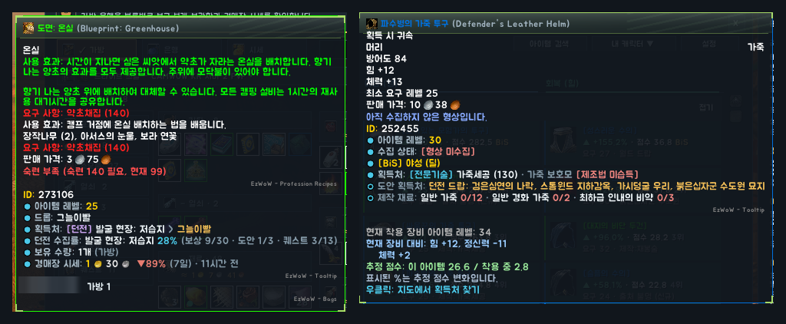
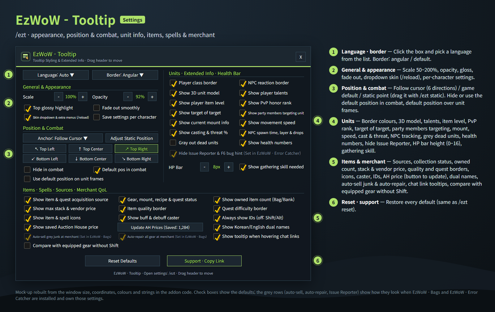
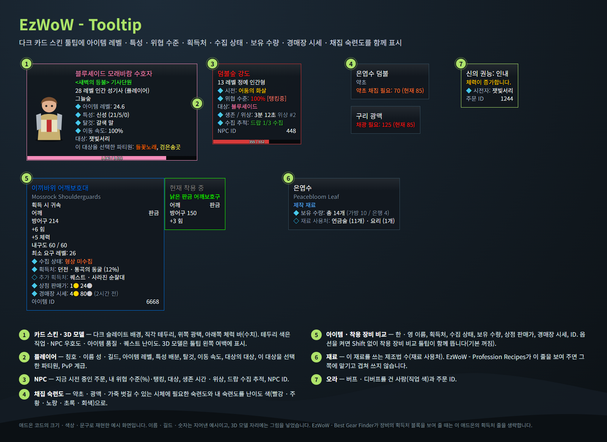
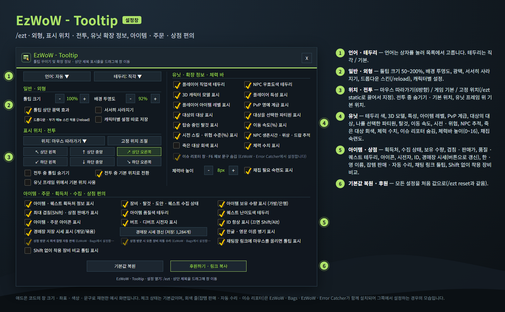

<!--
CurseForge summary (EN): Clean dark tooltips with item level, talents, threat, item sources, collection status, owned count, AH prices, gathering skill and optional gear comparison without Shift.
-->

# EzWoW - Tooltip

**English** · [한국어](#한국어)

Clean dark card tooltips for WoW Forever, with extra information on players, NPCs, items, herbs and ore, spells and auras.

*Mock-ups rebuilt from the sizes, colours and strings in the addon code. Names and numbers are made up.*

## Features

### Card skin
- Dark slate background, angular or default border, top gloss, optional fade-out, health bar with numbers.
- Border colour follows class, NPC reaction, item quality or quest difficulty.
- Optional 3D model of the unit in the tooltip's left margin. Scale 50–200%, opacity, and follow-cursor (6 directions), default or static position.
- Lines added by this addon end with a small grey "EzWoW - Tooltip" tag.

### Players and NPCs
- Players: title, first name and surname, guild, average item level, talent split, mount, movement speed, target of target, party members targeting the unit, PvP rank.
- NPCs: current cast, your threat (%) and tanking, target, alive time and layer, drop and quest tracking, NPC ID.

### Items
- Korean/English names side by side, item sources (dungeon, boss, quest, vendor, craft, world drop), collection status, bag/bank count, max stack, vendor price, saved Auction House price, IDs.
- Reagents show how many recipes use them.
- **Compare with equipped gear without Shift** (option, off by default).
- Hover chat links to see their tooltip without clicking.

### Gathering skill
- Herbs, ore veins and skinnable corpses show the skill they need and your current skill, in difficulty colours.

### Spells and auras
- Who cast a buff or debuff (class colour), spell ID and icon.

### Merchant
- Auto-sell grey junk and auto-repair (hold Shift to skip), Auction House prices collected while you browse.

## Working with other EzWoW addons
- **EzWoW - Bags** installed: auto-sell and auto-repair are set there; the options here turn grey. The AH price line also shows its change against the 7-day average from the Bags price history.
- **EzWoW - Error Catcher** installed: hiding the Issue Reporter is set there.
- **EzWoW - Best Gear Finder** shows a source block on gear: this addon leaves out its own source lines for that item.
- **EzWoW - Profession Recipes** shows "used in" and recipe learned status: this addon leaves out its own lines for that item.

## Gamepad
- With the gamepad UI on, EzWoW windows work with a gamepad: D-pad to move, A (✕) to press, X (□) for right-click, LB/RB to scroll, B (○) to close. A key guide in your pad's button style shows under the window.
- With no game window open, press **View (Back) / Create** to move to the EzWoW frames on screen. Press it again or B to go back.
- To use another button: Key Bindings > AddOns > EzWoW > "Gamepad: move to / leave the EzWoW frames" (with EzWoW-MapFinder installed).

## Record sharing
- Shared by all EzWoW addons and **on by default**: quest NPCs, rare monster sightings, item drops and gathering spots you have seen yourself are shared with other EzWoW users.
- `/ezshare on` / `off`, `/ezshare channel on` / `off`, `/ezshare status`

## Commands
- `/ezt` (`/et`, `/eztooltip`, `/ezwowtooltip`, `/툴팁`) — open the settings
- `/ezt static` — place the static tooltip position
- `/ezt reset` — restore all defaults
- `/ezt lang auto|ko|en|de|fr|es|ru|cn|tw` — change the language

Languages: English, 한국어, Deutsch, Français, Español, Русский, 简体中文, 繁體中文.

---

## 한국어

WoW Forever용 다크 카드 스타일 툴팁입니다. 플레이어 · NPC · 아이템 · 약초와 광맥 · 주문과 오라에 정보를 더 붙여 줍니다.

*애드온 코드의 크기 · 색상 · 문구로 재현한 예시 화면입니다. 이름과 숫자는 지어낸 예시입니다.*

## 기능

### 카드 스킨
- 다크 슬레이트 배경, 직각/기본 테두리, 위쪽 광택, 서서히 사라지기, 수치가 보이는 체력 바.
- 테두리 색은 직업 · NPC 우호도 · 아이템 품질 · 퀘스트 난이도를 따릅니다.
- 툴팁 왼쪽 여백에 3D 모델 표시(선택). 크기 50~200%, 투명도, 마우스 따라가기(6방향) · 게임 기본 · 고정 위치.
- 이 애드온이 덧붙인 줄 끝에는 작은 회색 "EzWoW - Tooltip" 표시가 붙습니다.

### 플레이어 · NPC
- 플레이어: 칭호, 이름 성, 길드, 평균 아이템 레벨, 특성 배분, 탈것, 이동 속도, 대상의 대상, 이 대상을 선택한 파티원, PvP 계급.
- NPC: 시전 중인 주문, 내 위협 수준(%) · 탱킹, 대상, 생존 시간 · 위상, 드랍 · 퀘스트 수집 추적, NPC ID.

### 아이템
- 한 · 영 이름 병기, 획득처(던전 · 보스 · 퀘스트 · 상인 · 제작 · 월드 드랍), 수집 상태, 가방/은행 보유 수량, 최대 겹침, 상점 판매가, 저장된 경매장 시세, ID.
- 재료에는 그 재료를 쓰는 제조법 수를 표시합니다.
- **Shift 없이 착용 장비 비교** (옵션, 기본 꺼짐).
- 채팅창 링크에 마우스를 올리기만 해도 툴팁 표시.

### 채집 숙련도
- 약초 · 광맥 · 가죽을 벗길 수 있는 시체에 필요한 숙련도와 내 숙련도를 난이도 색으로 표시합니다.

### 주문 · 오라
- 버프 · 디버프를 건 사람(직업 색), 주문 ID, 아이콘.

### 상점
- 회색 잡템 자동 판매 · 자동 수리(Shift를 누르면 건너뜀), 경매장을 둘러볼 때 시세 저장.

## 다른 EzWoW 애드온과 함께 쓰기
- **EzWoW - Bags**가 있으면 잡템 판매 · 자동 수리는 그쪽에서 설정합니다(이 애드온의 칸은 회색). 경매장 시세 줄에는 EzWoW - Bags 시세 기록의 7일 평균 대비 등락도 붙습니다.
- **EzWoW - Error Catcher**가 있으면 이슈 리포터 숨김은 그쪽에서 설정합니다.
- **EzWoW - Best Gear Finder**가 장비의 획득처 블록을 보여 주면 이 애드온은 그 아이템의 획득처 줄을 생략합니다.
- **EzWoW - Profession Recipes**가 재료 사용처 · 도안 배움 상태를 보여 주면 이 애드온은 그 줄을 생략합니다.

## 게임패드
- 게임패드 UI를 켜면 EzWoW 창을 패드로 다룰 수 있습니다. 방향키로 이동, A(✕)로 누르기, X(□)로 오른쪽 클릭, LB/RB로 스크롤, B(○)로 닫기입니다. 창 아래에 연결된 패드 모양으로 키 안내가 나옵니다.
- 블리자드 창이 열려 있지 않을 때 **보기(Back) / Create 버튼**을 누르면 화면의 EzWoW 프레임으로 이동합니다. 다시 누르거나 B를 누르면 돌아갑니다.
- 다른 버튼을 쓰려면: 설정 > 단축키 > 애드온 > EzWoW > "게임패드: EzWoW 창으로 이동/돌아가기" (EzWoW-MapFinder 설치 시)

## 기록 공유
- 모든 EzWoW 애드온이 함께 쓰며 **기본으로 켜져 있습니다**. 직접 확인한 퀘스트 NPC, 희귀 몬스터 목격, 아이템 드롭, 채집 위치를 다른 EzWoW 사용자와 나눕니다.
- `/ezshare on` / `off` (또는 `/공유`), `/ezshare channel on` / `off`, `/ezshare status`

## 명령어
- `/ezt` (`/et`, `/eztooltip`, `/ezwowtooltip`, `/툴팁`) — 설정창 열기
- `/ezt static` — 고정 위치 조절
- `/ezt reset` — 모든 설정 초기화
- `/ezt lang auto|ko|en|de|fr|es|ru|cn|tw` — 언어 변경

지원 언어: English, 한국어, Deutsch, Français, Español, Русский, 简体中文, 繁體中文.

---

**Support:** If you find this addon useful, you can support its development. [Buy Me a Coffee ☕](https://buymeacoffee.com/qqhrqqhr2)

**후원:** 애드온이 도움이 되셨다면 개발 후원으로 응원해 주세요. [Buy Me a Coffee ☕](https://buymeacoffee.com/qqhrqqhr2)

---

**Data credits:** Most item drop and vendor sources come from **Classic-DB** of the CMaNGOS project ([cmangos/classic-db](https://github.com/cmangos/classic-db), GNU GPL v3). Its license ships with the addon (`LICENSE-DATA.md`).

**데이터 출처:** 아이템 드롭처·판매처 상당수는 CMaNGOS 프로젝트의 **Classic-DB**([cmangos/classic-db](https://github.com/cmangos/classic-db), GNU GPL v3)에서 가져왔습니다. 라이선스 파일(`LICENSE-DATA.md`)을 애드온에 함께 넣었습니다.
